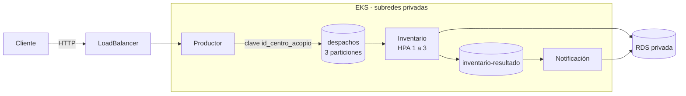

@'
# AgroLink Andes · Despachos dirigidos por eventos en Kubernetes (AWS)

Examen complexivo · Programación Distribuida · Caso 2
Universidad Central del Ecuador · **Autor:** Andy Alarcon

## Qué hace

Plataforma que procesa las guías de despacho de AgroLink Andes. En cosecha el volumen se multiplica por diez y el sistema anterior perdía registros. Aquí cada guía viaja como un **evento**:

1. El **productor** recibe la guía por HTTP (`POST /despachos`) y la publica en Kafka.
2. El **inventario** la lee, descuenta el stock en una base PostgreSQL privada y publica el resultado.
3. La **notificación** lee el resultado y avisa al transportista.

Cada parte escala por separado, ninguna guía se pierde si cae un pod, y la base de datos no es accesible desde Internet.

## Arquitectura

## Qué se destaca

| Requisito | Cómo se cumple |
|---|---|
| Orden por bodega | La clave de partición es `id_centro_acopio` |
| Escalado independiente | Dos grupos de consumidores; el inventario usa HPA de 1 a 3 pods |
| Ninguna guía se pierde | El offset se confirma solo después de guardar en la base |
| Nunca se descuenta dos veces | `id_guia` es clave primaria (idempotencia) |
| Base de datos aislada | Subred privada, sin IP pública, 5432 solo desde el SG del clúster |
| Despliegue sin cortes | `RollingUpdate` con `maxUnavailable: 0` y sonda readiness |
| Infraestructura reproducible | Terraform con estado remoto en S3 y proveedores fijados |
| Imágenes seguras | Dockerfile multietapa, usuario no root, tag por hash, ECR inmutable |

## Estructura

| Carpeta | Contenido | Documentación |
|---|---|---|
| `terraform/` | VPC, EKS, RDS y ECR (28 recursos) | [terraform/README.md](terraform/README.md) |
| `k8s/` | Kafka, ConfigMap, productor, inventario con HPA y notificación | [k8s/README.md](k8s/README.md) |
| `services/` | Los 3 servicios en Python con su Dockerfile | [services/README.md](services/README.md) |
| `scripts/` | Envío de guías y monitor de disponibilidad | [scripts/README.md](scripts/README.md) |
| `docs/` | Diagramas e imágenes | |

## Requisitos

Terraform 1.10+, AWS CLI 2, kubectl, Docker y Python 3.11. Entorno: AWS Academy Learner Lab (`us-east-1`, rol `LabRole`).

## Despliegue resumido

cd terraform
terraform init
terraform apply
cd ..
aws eks update-kubeconfig --name agrolink-eks --region us-east-1

Luego se suben las imágenes a ECR, se instala metrics-server, se aplican los manifiestos y se crean los tópicos. El procedimiento completo está en [k8s/README.md](k8s/README.md) y [services/README.md](services/README.md).

Valores que cambian en cada creación: `DB_HOST` en `k8s/01-config.yaml`, el ID de cuenta y el tag en las imágenes, y la dirección del LoadBalancer en `scripts/`.

## Probarlo

1. Abrir `http://DIRECCION-DEL-LB/docs` y ejecutar `POST /despachos`. Debe responder 202.
2. Consultar el inventario (no es público) con un túnel:

kubectl port-forward svc/consumidor-inventario 8081:80

3. En `http://localhost:8081/docs`: `GET /guias`, `GET /guias/resumen` y `GET /inventario`.

## Pruebas realizadas

| ID | Prueba | Resultado |
|---|---|---|
| P1 | Tópico con 3 particiones | ✅ |
| P2 | Misma clave, misma partición | ✅ |
| P3 | Grupos sin retraso (LAG 0) | ✅ |
| P4 | Escalado de 1 a 3 réplicas con rebalanceo | ✅ |
| P5 | Borrar un pod durante el envío: 0 guías perdidas | ✅ |
| P6 | Rolling update del productor: 0 errores | ✅ |
| P7 | BD inaccesible desde Internet | ✅ |
| P8 | HPA bajo carga | ⏳ |

| Antes del escalado | Después del escalado |
|---|---|
|  |  |

## Costo y limitaciones

Costo estimado ~0,27 USD por hora (dos nodos t3.medium, EKS, NAT, RDS y balanceador). Consumo real en el laboratorio: USD 22,1 de 50.

Limitaciones del prototipo: un solo broker de Kafka con disco efímero, un NAT, RDS en una zona y rol `LabRole`. En producción: 3 brokers o MSK, Multi-AZ, un NAT por zona y roles con mínimo privilegio.

## Destruir
kubectl delete -f k8s/02-productor.yaml
cd terraform
terraform destroy

Primero se borra el balanceador que creó Kubernetes; si no, la VPC no se puede eliminar.
'@ | Set-Content -Encoding utf8 README.md